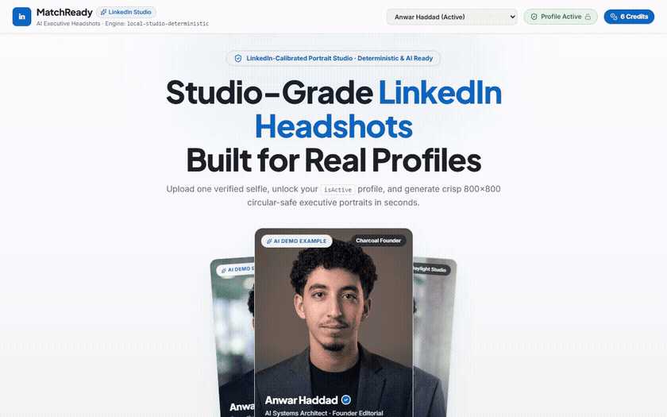
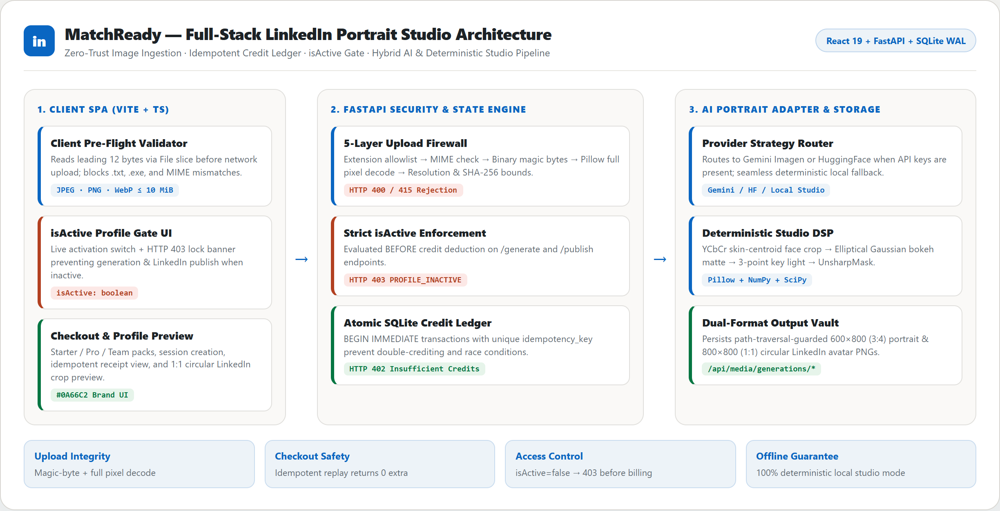
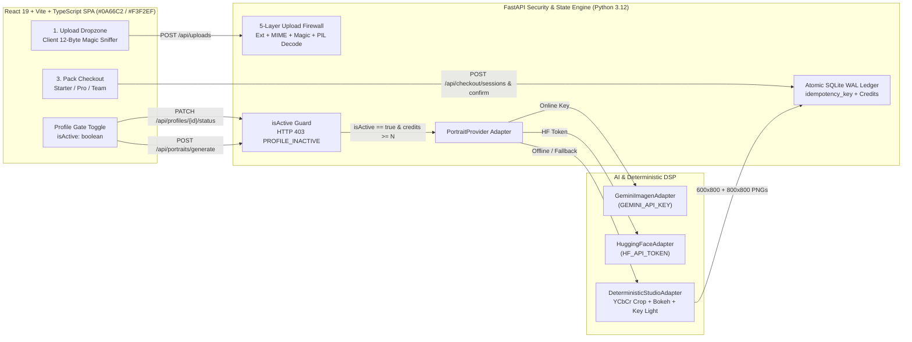
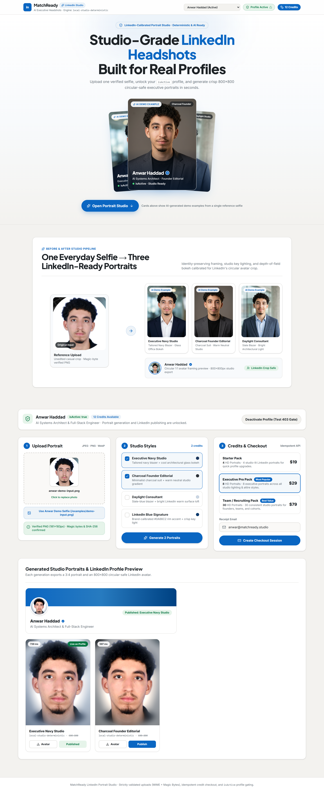
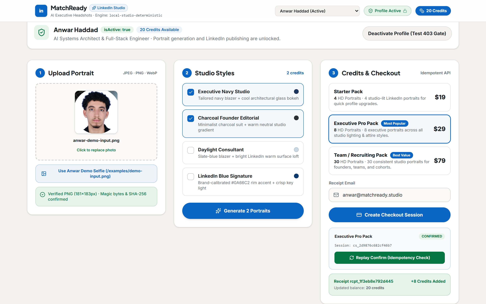
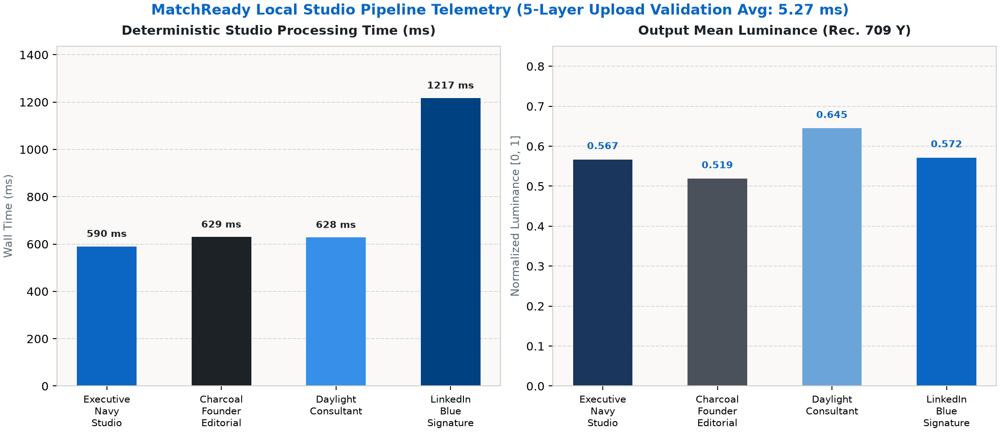

<div align="center">

# MatchReady — LinkedIn AI Headshot & Portrait Studio

**Full-Stack LinkedIn Portrait Studio with Zero-Trust Image Ingestion, Idempotent Credit Checkout, `isActive` Profile Gating, and Hybrid AI / Deterministic Studio DSP**

[](docs/PROOF_OF_WORK.md)
[](docs/PROOF_OF_WORK.md)
[](tsconfig.json)
[](backend/app/main.py)

</div>

---

## Live Studio Walkthrough



> **Full-resolution recording:** [docs/images/studio-walkthrough.webm](docs/images/studio-walkthrough.webm) (captured via headless Playwright Chromium against live FastAPI + SQLite + Vite preview servers, demonstrating the `isActive` HTTP 403 lock/unlock toggle, magic-byte-verified upload, deterministic portrait generation, idempotent credit checkout, and LinkedIn profile publishing).

---

## System Architecture





---

## AI-Generated LinkedIn Demo Previews & Real UI Screenshots

> **Transparency Note:** The three executive headshot examples below (`linkedin-executive-navy.png`, `linkedin-charcoal-founder.png`, `linkedin-daylight-consultant.png`) are **AI-generated demo examples** synthesized from the reference input photo (`demo-input.png`) to illustrate target LinkedIn studio styles. All UI screenshots and telemetry figures are captured from real local executions.

| Reference Input Selfie | Executive Navy Studio (AI Demo) | Charcoal Founder Editorial (AI Demo) | Daylight Consultant (AI Demo) |
| :---: | :---: | :---: | :---: |
|  |  |  |  |

### Desktop Studio (`1440×900`) & Mobile Responsive (`390×844`)

| Desktop Studio (`1440×900` Full Page) | Mobile Viewport (`390×844`) | Checkout & Idempotent Receipt |
| :---: | :---: | :---: |
|  |  |  |

---

## Engineering & Mathematical Design

### 1. Five-Layer Image Upload Firewall (`backend/app/validation.py` & `src/lib/validation.ts`)
To prevent arbitrary file upload vulnerabilities, MIME spoofing, and parser exploits, every upload passes five independent checks before disk persistence:
1. **Size & Empty Guard**: Rejects `0`-byte payloads and files exceeding `10 MiB` (`HTTP 400 EMPTY_FILE` / `FILE_TOO_LARGE`).
2. **Filename Extension Allowlist**: Restricts suffixes to `.jpg`, `.jpeg`, `.png`, `.webp` (`HTTP 415 UNSUPPORTED_EXTENSION`).
3. **Declared MIME Allowlist**: Restricts `Content-Type` to `image/jpeg`, `image/png`, `image/webp` (`HTTP 415 UNSUPPORTED_MIME_TYPE`).
4. **Binary Magic-Byte Verification & Consistency**: Inspects leading header signatures (`FF D8 FF` for JPEG, `89 50 4E 47 0D 0A 1A 0A` for PNG, `RIFF....WEBP` for WebP). Rejects `.txt`, Windows PE `.exe` (`MZ\x90\x00`), and spoofed extensions/MIME mismatches (`HTTP 415 INVALID_MAGIC_BYTES`, `MIME_MAGIC_MISMATCH`, `EXTENSION_MAGIC_MISMATCH`).
5. **Structural Pixel Decode & Dimension Bounds**: Runs Pillow `Image.verify()` followed by full pixel decode (`load()`) under a `64 MP` decompression-bomb cap (`Image.MAX_IMAGE_PIXELS`), enforcing `128px <= width, height <= 8192px` and computing `SHA-256`.

### 2. `isActive` Profile Status Gating (`backend/app/main.py`)
User profiles carry an explicit `isActive: boolean` state persisted in SQLite (`is_active INTEGER`). Both `POST /api/portraits/generate` and `POST /api/portraits/{id}/publish` enforce `_require_active_profile()` **before** credit deduction or rendering:
- When `isActive === false`, the API returns **HTTP `403 Forbidden`** (`code: "PROFILE_INACTIVE"`), guaranteeing zero credits are spent.
- The frontend mirrors this state in the sticky header pill, profile status banner, and disabled/locked Generate CTA.

### 3. Idempotent Checkout & Atomic Credit Ledger (`backend/app/checkout.py`)
- **Tiered Packs**: Starter (`$19` / `4` credits), Executive Pro (`$29` / `8` credits), Team/Recruiting (`$79` / `30` credits).
- **Idempotency**: `POST /api/checkout/sessions` deduplicates by unique `idempotency_key`. `POST /api/checkout/confirm` executes inside a SQLite `BEGIN IMMEDIATE` transaction; replaying confirmation on an already-`confirmed` session returns `idempotentReplay: true` and `creditsAdded: 0` with the original `receiptId`.
- **Atomic Billing**: Credit deduction runs inside `BEGIN IMMEDIATE` with `Insufficient Credits` returning **HTTP `402 Payment Required`**.

### 4. Deterministic Studio DSP Pipeline (`backend/app/pipeline.py`)
When `GEMINI_API_KEY` or `HF_API_TOKEN` is absent or offline, `DeterministicStudioAdapter` runs a reproducible image-processing pipeline producing both a `600×800` (3:4) editorial portrait and an `800×800` (1:1) circular-safe LinkedIn avatar:
1. **Skin-Chroma Centroid Cropping**: Converts RGB to $\text{Y}C_bC_r$ and evaluates a bivariate Gaussian likelihood centered at $(C_b^*, C_r^*) = (103, 150)$ weighted by a portrait headroom prior to anchor eye-line framing at $40\%$ vertical height:
   $$w(x,y) = \exp\!\left(-\frac{(C_b-103)^2 + (C_r-150)^2}{2 \cdot 18^2}\right) \cdot \exp\!\left(-\frac{(x-0.5)^2}{2\cdot 0.35^2} - \frac{(y-0.38)^2}{2\cdot 0.30^2}\right)$$
2. **Elliptical Bokeh Matte**: Computes a normalized elliptical subject mask $M(x,y)$ smoothed via Gaussian convolution ($\sigma = 0.02 \cdot \max(W,H)$) to preserve crisp facial hair/ear boundaries while blending outer background pixels into a calibrated studio gradient + Gaussian bokeh blur.
3. **Three-Point Lighting & Micro-Sharpening**: Applies radial key-light illumination boost centered near $(0.45W, 0.36H)$, style-calibrated warm/cool white balance, subtle edge vignette, contrast grading, and `UnsharpMask` (`radius=1.2, percent=95`).



Observed local telemetry on `demo-input.png` (`5` validation iterations + `4` studio presets):
- **5-Layer Upload Validation Average**: `5.27 ms`
- **Deterministic Studio Latency**: `590.03 ms` (`executive_navy`), `629.45 ms` (`charcoal_founder`), `627.90 ms` (`daylight_consultant`), `1216.80 ms` (`linkedin_signature`)
- **Output Rec. 709 Mean Luminance**: `0.519` (Charcoal Founder) to `0.645` (Daylight Consultant)

---

## Tools, Skills, AI Models & Stack

- **Frontend Stack**: React `19.2`, TypeScript `5.8`, Vite `6.4`, Tailwind CSS `v4`, Framer Motion `12.23`, Lucide Icons `0.555`
- **Backend Stack**: Python `3.12`, FastAPI, Pydantic Settings, SQLite (WAL mode + `BEGIN IMMEDIATE` atomic transactions), Pillow `12.3`, NumPy `2.5`, SciPy `1.18`, HTTPX
- **AI Models & Adapters**:
  - `GeminiImagenAdapter` (`gemini-2.5-flash-image` REST adapter when `GEMINI_API_KEY` is configured)
  - `HuggingFaceAdapter` (optional `HF_API_TOKEN` inference adapter)
  - `DeterministicStudioAdapter` (100% offline reproducible DSP studio processor)
  - Demo portrait previews in `public/examples/` & `docs/images/` synthesized via image-to-image generation from the reference portrait
- **Verification & QA Tooling**: `pytest` (backend API + security + idempotency + gating tests), `vitest` + `@testing-library/react` + `jsdom` (frontend unit & UI gate tests), `tsc --noEmit`, `vite build`, Playwright headless Chromium (desktop `1440×900`, mobile `390×844`, `.webm` screen recording), FFmpeg (`palettegen`/`paletteuse` GIF conversion), Matplotlib (telemetry charts)

---

## Local Setup & Run

### 1. Start the FastAPI Backend
```bash
python -m pip install -r backend/requirements.txt
python -m uvicorn backend.app.main:app --host 127.0.0.1 --port 8000 --reload
```

### 2. Start the React + Vite Frontend
```bash
npm install
npm run dev
```
Open `http://127.0.0.1:3000`. Vite proxies `/api/*` directly to FastAPI on `127.0.0.1:8000`.

### 3. Run All Tests & Builds
```bash
python -m pytest -v backend/tests/test_api.py
npm run typecheck
npm test
npm run build
```

---

## Documentation

- [Engineering Case Study](docs/CASE_STUDY.md)
- [Proof of Work & Verification Log](docs/PROOF_OF_WORK.md)
